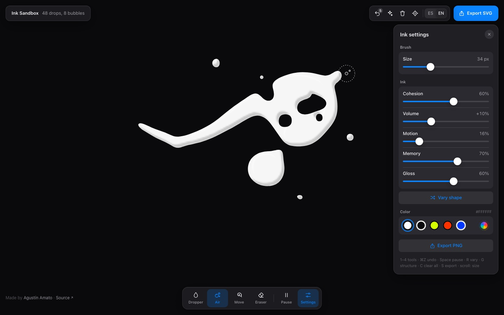

# Ink Sandbox

Drop ink that fuses into liquid shapes, blow air bubbles into it, and export the result as a clean vector SVG.

[Español más abajo ↓](#español)



**[Open Ink Sandbox →](https://amatosaurio22.github.io/ink-sandbox/)**

---

## What you can do

- **Dropper.** Click for a drop, hold to let it grow, drag to draw a stroke that thins with speed.
- **Air.** Blow bubbles into ink that is already there. Hold to inflate one, drag to leave foam. Bubbles are real holes: they push the ink aside, move with it, and pop when the ink around them is gone.
- **Move and Eraser.** Stretch and gather the ink, or remove it.
- **Ink settings.** Cohesion, volume, motion, memory and gloss, five colors plus a custom one.
- **Export.** SVG is one compound path, bubbles kept as holes, with every setting stored in `<metadata>`. PNG keeps the gloss.
- Up to 1,000 drops, 50-step undo, pause, a structure view, Spanish and English, mouse, touch and pen.

| Key | Action |
| --- | --- |
| `1` `2` `3` `4` | Dropper, Air, Move, Eraser |
| `⌘Z` / `Ctrl+Z` | Undo |
| `Space` | Pause / resume |
| `R` | Vary shape |
| `G` | Show structure |
| `C` | Clear all |
| `S` | Export SVG |
| Scroll | Brush size |

## How it works

```
pointer → drops (position, anchor, radius) and bubbles (position, radius)
        → physics: local cohesion + anchor spring + air pressure       js/ink.js
        → metaball field on an 8 px grid, bubbles carved out of it     js/ink.js
        → marching squares → smoothed loops → cubic Bézier path        js/contour.js
        → one Path2D fill + gloss derived from the same contour        js/press.js
```

1. **Drops** pull on their near neighbours and repel inside a rest distance, so strokes keep their width. A spring ties each drop to where it landed, so the drawing breathes without sliding away.
2. **The field** sums a smooth falloff per drop. A little noise is added only near the edge, so the outline moves without drifting.
3. **Bubbles** multiply the field by a soft radial mask and push nearby drops outward, so the ink makes lasting room for the air.
4. **The outline** is traced with marching squares and turned into Bézier curves. The canvas fills that exact path, so what you see is what you export.
5. **Gloss** reuses the outline: shifted towards and away from the light it gives a soft shadow and a lit rim, and tracing the field again where the ink is thickest gives the reflections.

No framework, no build step, no dependencies: Canvas 2D, Pointer Events and ES modules. A frame with 1,000 drops takes about 3 ms of simulation.

## Run it locally

```bash
python3 -m http.server 5173
```

Open <http://localhost:5173>. Add `?lang=en` or `?lang=es` to pick a language.

## Files

```
index.html        markup and icons
css/style.css     interface
js/app.js         tools, frame loop, history, controls
js/ink.js         drops, bubbles, physics, field
js/contour.js     marching squares and SVG path
js/press.js       ink, gloss, cursors, SVG/PNG export
js/i18n.js        Spanish and English text
js/noise.js       random numbers and Perlin noise
assets/           icon, social image, screenshot
```

## Credits

Design and code by **Agustín Amato**. MIT License, see [LICENSE](LICENSE).

---

## Español

Soltá gotas de tinta que se funden en formas líquidas, soplales burbujas de aire y exportá el resultado como SVG vectorial.

**[Abrir Ink Sandbox →](https://amatosaurio22.github.io/ink-sandbox/?lang=es)**

- **Gotero.** Un clic suelta una gota, mantener la hace crecer, arrastrar dibuja un trazo que se afina con la velocidad.
- **Aire.** Soplá burbujas dentro de la tinta. Mantené para inflar, arrastrá para hacer espuma. Son huecos reales: corren la tinta, se mueven con ella y explotan si se quedan sin tinta alrededor.
- **Mover y Goma.** Estirá y juntá la tinta, o borrala.
- **Ajustes de tinta.** Cohesión, volumen, movimiento, memoria y brillo, cinco colores y uno a elección.
- **Exportar.** El SVG es un solo trazado con las burbujas como huecos y los ajustes guardados en `<metadata>`. El PNG incluye el brillo.
- Hasta 1.000 gotas, 50 pasos de deshacer, pausa, vista de estructura, español e inglés, mouse, touch y lápiz.

Para correrlo localmente: `python3 -m http.server 5173` y abrí <http://localhost:5173>.

Diseño y código: **Agustín Amato**. Licencia [MIT](LICENSE).
